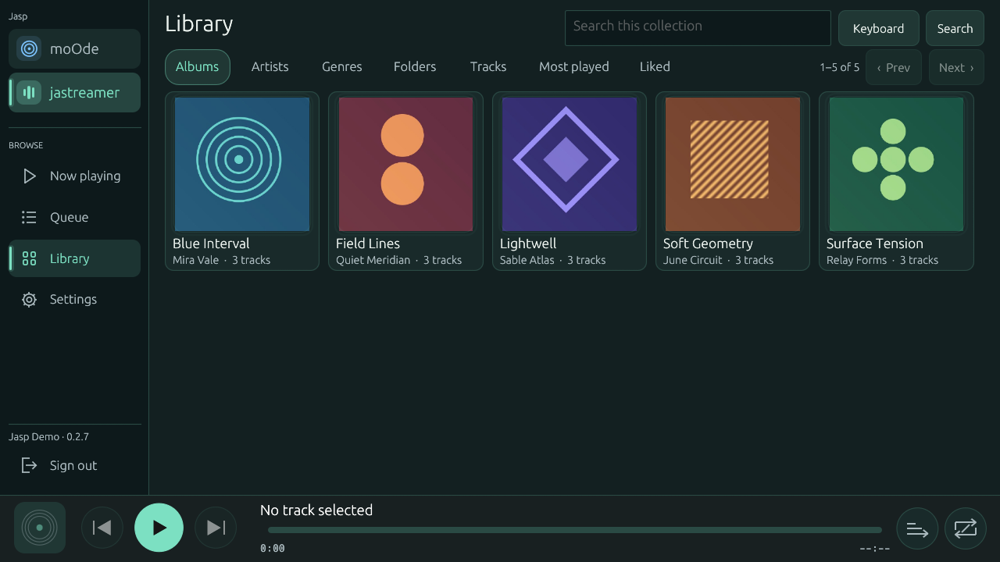
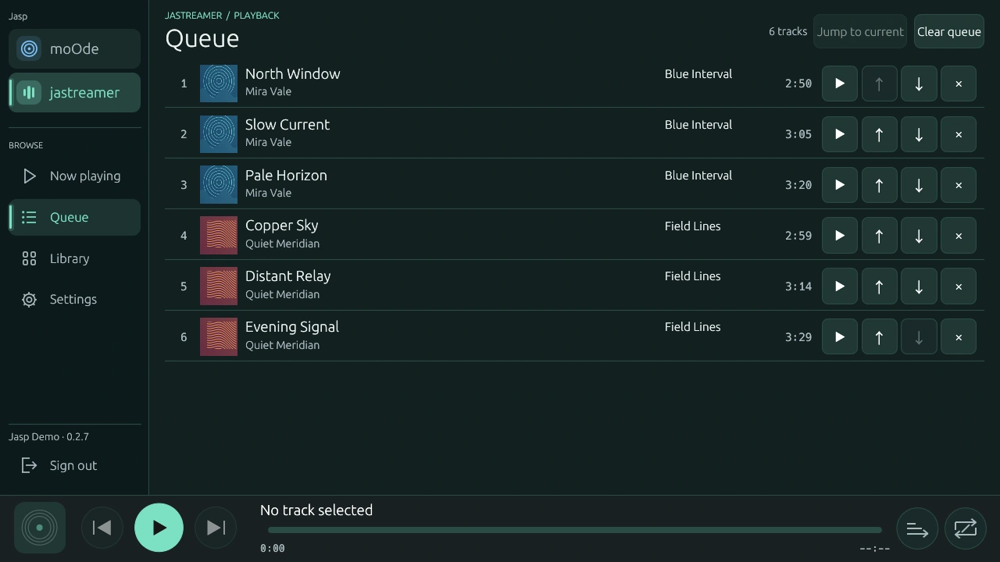
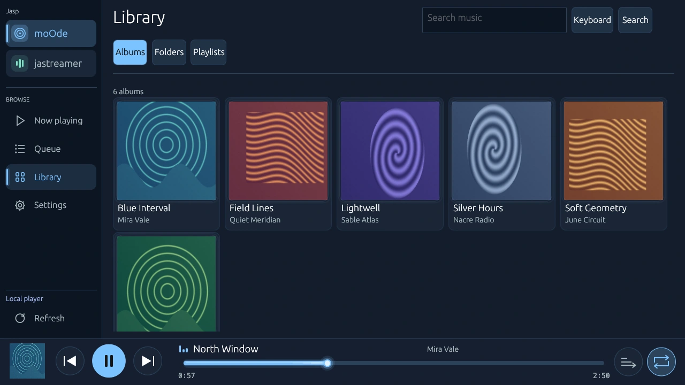
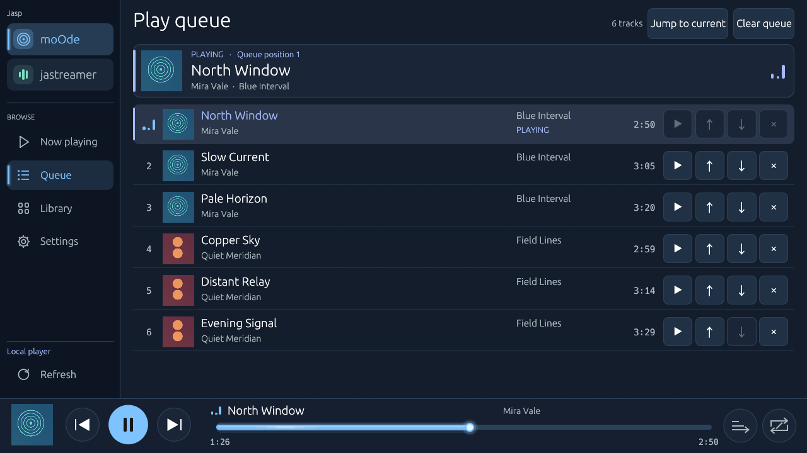

# Jasp

[English](README.md) · **한국어** · [제품 소개](https://furyheimdall.github.io/jasp/ko/)

Jasp는 Rust로 개발한 **Raspberry Pi용 네이티브 jastreamer 음악 플레이어**입니다. 기존 [jastreamer Server](https://github.com/furyheimdall/jastreamer)에 연결해 라이브러리를 탐색하고 대기열을 관리하며, Pi에 연결된 USB DAC으로 음악을 재생합니다.

Raspberry Pi 데스크톱 앱이나 전체 화면 터치스크린 키오스크로 실행할 수 있습니다. Jasp는 재생기이며 jastreamer Server를 대신하지 않습니다.

- **moOde UI 프런트엔드(선택):** Pi의 로컬 화면에서 [moOde](https://moodeaudio.org/) 웹 플레이어 대신 사용할 수 있습니다. 기존 moOde 백엔드, MPD, 라이브러리는 그대로 사용합니다.

## 주요 기능

- **재생 화면:** 재생 위치를 터치로 조절하고, 앨범 표지를 눌러 곡 정보를 확인할 수 있습니다. 셔플과 반복 재생을 지원하며 디코딩부터 USB 출력까지 오디오 신호 경로를 표시합니다.
- **라이브러리와 대기열:** 앨범과 폴더를 탐색하고, 곡을 바로 재생하거나 다음 곡 또는 대기열 끝에 추가할 수 있습니다. 곡 순서 변경, 대기열 비우기, 라이브러리 스캔도 앱에서 할 수 있습니다.
- **USB 오디오:** 모노·스테레오 FLAC과 MP3를 Pi에서 디코딩하고, 소프트웨어 믹싱·리샘플링·채널 변환 없이 PCM을 USB DAC으로 직접 보냅니다. jastreamer와 moOde가 같은 USB DAC을 사용할 때는 전환 전에 확인을 요청합니다.
- **화면 설정:** 한국어와 영어, 플레이어별 색상 테마, 터치 키보드를 지원합니다.

**비트 퍼펙트 표시**는 DAC 출력의 실측값이 아니라 앱에서 확인한 재생 경로를 기준으로 합니다.

## 스크린샷

### jastreamer





### moOde





## 설치와 실행

[릴리스](https://github.com/furyheimdall/jasp/releases)에서 ARM64 `.deb`와 SHA-256 체크섬을 내려받으세요. 패키지는 **64비트 Raspberry Pi OS 또는 Debian 13(Trixie)** 용입니다. Pi에서 다음 명령을 실행하세요.

```sh
sha256sum -c jasp_0.1.3_arm64.deb.sha256
sudo apt install ./jasp_0.1.3_arm64.deb
```

| 환경 | 첫 실행 | 자동 시작을 켰을 때 |
| --- | --- | --- |
| Raspberry Pi OS Desktop (X11·Wayland) | 앱 메뉴에서 **Jasp**를 열거나 데스크톱 터미널에서 `jasp`를 실행합니다. | 데스크톱에 로그인하면 Jasp가 열립니다. |
| Raspberry Pi OS Lite | Pi의 로컬 콘솔에 일반 사용자로 로그인해 `jasp`를 실행합니다. | 자동 시작을 선택하고 콘솔에서 `sudo`를 승인하면 다음 부팅부터 전체 화면 키오스크가 열립니다. |
| **Local Display**가 켜진 moOde | 로컬 화면 사용자로 `DISPLAY=:0 jasp --server http://127.0.0.1 --fullscreen`을 실행합니다. | Pi 화면에 자동으로 열리는 앱만 바뀝니다. moOde 서버와 오디오 설정은 변경하지 않습니다. |

자동 시작은 기본적으로 꺼져 있습니다. 지원되는 환경에서는 Jasp를 직접 실행할 때 자동 시작을 설정할지 묻습니다. 터미널에서는 `jasp autostart status`, `jasp autostart enable`, `jasp autostart disable`로 설정을 확인하거나 변경할 수 있습니다. Lite에서 권장 패키지를 건너뛰었다면 `cage libpam-systemd sudo`를 설치하세요.

moOde 웹 화면으로 되돌리려면 **설정 → Jasp → 다음 부팅 화면 → moOde 웹 UI**를 선택하거나 `jasp autostart disable`을 실행하세요. 다시 Jasp로 시작하려면 로컬 화면 사용자로 SSH에 접속해 `jasp autostart enable`을 실행하세요.

## 소스 빌드

Linux에서 Rust, `build-essential`, `pkg-config`, `libasound2-dev`를 설치한 뒤 빌드합니다.

```sh
cargo test --locked
cargo build --locked
./target/debug/jasp
```

ARM64 Trixie에서 배포 패키지를 만들려면 `python3`를 설치한 뒤 `packaging/build-deb`를 실행하세요. 결과는 `target/packages/`에 저장됩니다.

[MIT 라이선스](LICENSE)
