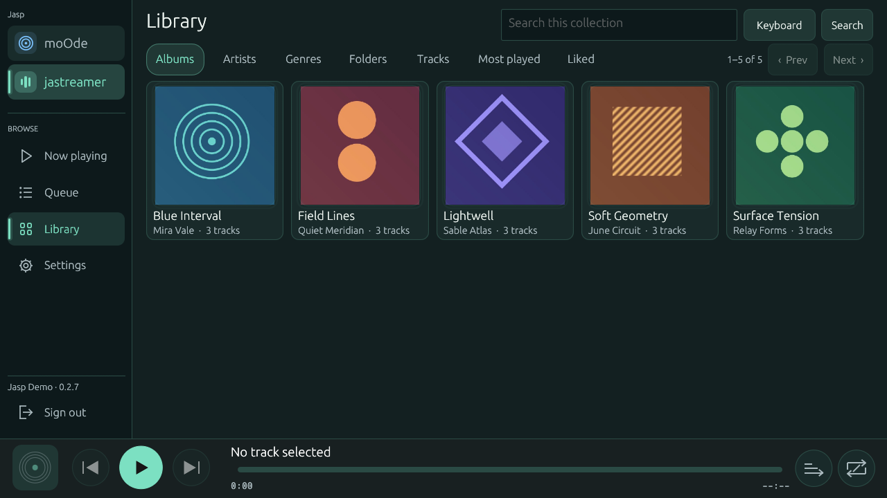
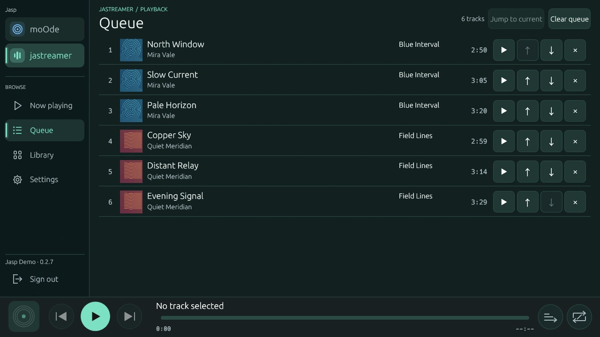
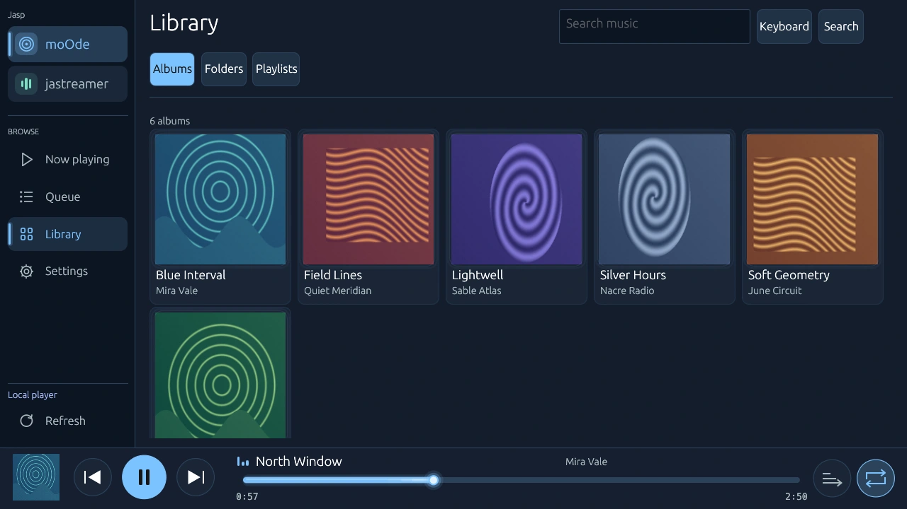
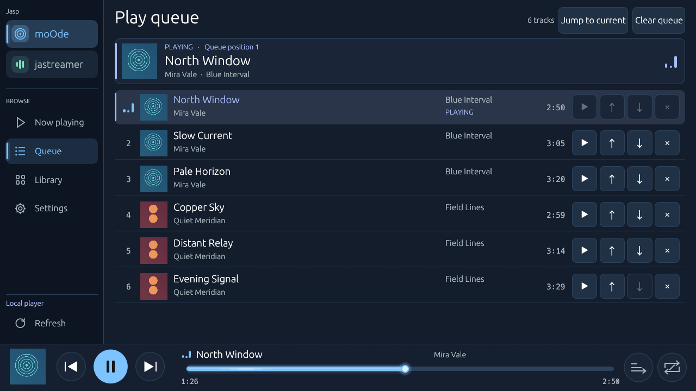

# Jasp

**English** · [한국어](README.ko.md) · [Product website](https://furyheimdall.github.io/jasp/)

Jasp is a native **jastreamer music player for Raspberry Pi**, written in Rust. It connects to an existing [jastreamer Server](https://github.com/furyheimdall/jastreamer) to browse its library, manage its queue, and play music through a USB DAC connected to the Pi.

Use Jasp on the Raspberry Pi desktop or run it as a fullscreen touchscreen kiosk. Jasp is the player; it does not replace jastreamer Server.

- **moOde UI frontend (optional):** Replaces the [moOde](https://moodeaudio.org/) web player on the Pi’s local display. Jasp uses the existing moOde backend, MPD, and library; it does not replace them.

## Features

- **Now Playing:** touch to seek or tap the cover for track details. Shuffle and repeat are built in, and the signal path shows decoding through to USB output.
- **Library and queue:** browse albums and folders, play them now or queue them for later, reorder or clear the queue, and scan for library changes.
- **USB audio:** Jasp decodes mono or stereo FLAC and MP3 locally and sends PCM directly to a USB DAC without a software mixer, resampling, or channel remix. Jasp asks before switching a shared USB DAC between jastreamer and moOde.
- **Touch settings:** use the settings sidebar to switch sections. In **General**, choose English or Korean and pick a color swatch for each player.
- **jastreamer library settings:** view configured sources and run scans on the Pi. Add, edit, or remove sources in the jastreamer web UI.

**Bit-perfect labels** describe the playback path Jasp can verify in software, not a measurement at the DAC.

### Kiosk display

In **Settings → Display**, changes take effect as you make them. A dedicated X11 kiosk can keep its screen on or use the system timeout. With a writable panel backlight, drag the brightness slider or use **− / +** for fine adjustment. Jasp can also turn off the backlight or dim it after 1–120 minutes. Touch the screen to restore its normal brightness. Desktop sessions keep their own screen and sleep settings.

## Screenshots

### jastreamer





### moOde





## Install and run

Download the ARM64 `.deb` and its SHA-256 checksum from [Releases](https://github.com/furyheimdall/jasp/releases). The package targets **64-bit Raspberry Pi OS / Debian 13 (Trixie)**. On the Pi:

```sh
sha256sum -c jasp_0.1.6_arm64.deb.sha256
sudo apt install ./jasp_0.1.6_arm64.deb
```

| Environment | First launch | What autostart does |
| --- | --- | --- |
| Raspberry Pi OS Desktop (X11 or Wayland) | Open **Jasp** from the app menu or run `jasp` in a desktop terminal. | Jasp opens after desktop login. |
| Raspberry Pi OS Lite | Log in as a regular user at the Pi’s local console and run `jasp`. | Accept autostart and approve `sudo` at the console. The fullscreen kiosk opens on the next boot. |
| moOde with **Local Display** enabled | As the local display user, run `DISPLAY=:0 jasp --server http://127.0.0.1 --fullscreen`. | Only the app shown on the Pi changes. The moOde server and audio settings stay the same. |

Autostart is off by default. On supported systems, Jasp offers to enable it when launched manually. Run `jasp autostart status`, `jasp autostart enable`, or `jasp autostart disable` to manage it from a terminal. On Lite, install `cage libpam-systemd sudo` if you skipped recommended packages.

To restore the local moOde web screen, choose **Settings → Jasp → Next boot → moOde Web UI**, or run `jasp autostart disable`. To switch back, SSH in as the local display user and run `jasp autostart enable`.

## Build

With Rust, `build-essential`, `pkg-config`, and `libasound2-dev` installed on a compatible Linux host:

```sh
cargo test --locked
cargo build --locked
./target/debug/jasp
```

To build the Debian package on ARM64 Trixie, install `python3` and run `packaging/build-deb`. The package is written to `target/packages/`.

[MIT license](LICENSE)
